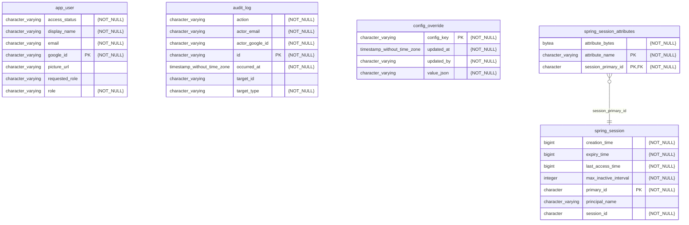

# Fullstack Starter

A template for building full-stack web applications with Google OAuth2 authentication.

## What is included

- Kotlin and Spring Boot 4 backend with session authentication and CSRF protection
- Next.js TypeScript frontend with backend calls proxied through Next.js API routes
- Google OAuth2 production and WireMock-backed local login profiles
- PostgreSQL, H2, Flyway, health endpoints, and Docker Compose deployment templates

## Prerequisites

- Java 17
- Node.js 24 and npm
- Docker and Docker Compose (optional)

## Profiles

Choose one profile from each resource group.

| Resource | Local/stub | Production |
|---|---|---|
| Database | `h2` | `postgres` |
| OAuth2 | `stub-google` | `prod-google` |
| Logging | `plain-log` (included by `local`) | default |
| Environment | `local` | `stage` or `prod` |

Local development uses `h2,stub-google,local`. Stage and production use only `stage` or `prod`; each environment profile includes `postgres` and `prod-google` and owns its non-secret deployment settings. Add the optional `demo-data` profile to seed local feature fixtures.

## Run locally

Run each command from the repository root.

Start the backend:

```bash
./gradlew :backend:bootRun --args='--spring.profiles.active=h2,stub-google,local'
```

Start the backend with pending access requests and audit records:

```bash
./gradlew :backend:bootRun --args='--spring.profiles.active=h2,stub-google,local,demo-data'
```

Start the frontend in another terminal:

```bash
npm install --prefix frontend; npm run dev --prefix frontend
```

The backend runs on `http://127.0.0.1:8080`; the frontend runs on `http://127.0.0.1:3000`.

Build the backend container image from the repository root:

```bash
./gradlew clean :backend:jibDockerBuild
```

Build the frontend container image from the repository root:

```bash
docker build -t generaltao725/fullstack-starter-frontend:latest frontend
```

For the complete local stack with published images:

```bash
docker compose --env-file templates/docker/.env.test -f templates/docker/docker-compose.yml -f templates/docker/docker-compose.ports-local.yml up
```

See [Deployment](docs/DEPLOYMENT.md) for production configuration and Compose requirements. See [Database](docs/DATABASE.md) for schema and migration management.

## Guides

- [Add a feature](docs/ADD_FEATURE.md)
- [Integrate an external API](docs/ADD_EXTERNAL_API.md)
- [Add or change an OAuth2 provider](docs/ADD_OAUTH2_PROVIDER.md)
- [Database and migrations](docs/DATABASE.md)
- [Testing](docs/TESTING.md)
- [Deployment](docs/DEPLOYMENT.md)

### PostgreSQL database ERD diagram

<!-- mermerd-start -->

<!-- mermerd-end -->
